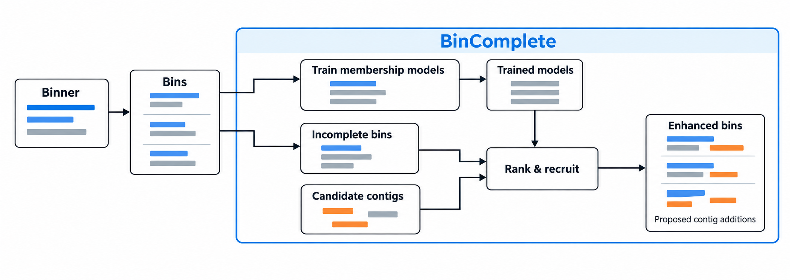

# BinComplete

**A Python package for metagenomic bin refinement through contig recruitment.**

Research beta. See the [documentation](https://ludvins.github.io/BinComplete/) to get started.

BinComplete operates after an existing metagenomic binner. It learns contig
membership from the bins that the binner produces, then uses those models to
rank candidate contigs for incomplete bins and propose enhanced bin memberships.
An analytic cosine method is also available without model training.

Training uses original bin memberships as supervision. CheckM2 scores and other
quality estimates are not used to select training sources, create labels, or
rank proposals.



The binner supplies the starting bins; BinComplete supplies candidate rankings
and proposed additions. Quality assessment remains a separate step using external
tools. Proposed additions do not by themselves establish a high-quality or
complete genome.

## How it works

1. **Prepare binner outputs.** Index the assembly, original bin memberships,
   coverage, and any supplied embeddings without copying the assembly.
2. **Train membership models.** Mask contigs from original training bins and learn
   which candidates belong with the remaining members. Training bins can come from
   the same assembly as the recipient bins or a separate compatible dataset.
3. **Refine incomplete bins.** Apply a chosen model to recipient bins and an
   eligible candidate pool. Generate ranked alternatives while preserving each
   recipient's original contigs.
4. **Review and export.** Evaluate proposed constructions externally, reconcile
   approved proposals into a compatible selection, and export refined bins.

The candidate pool defaults to contigs unassigned in the supplied memberships.
All supplied original bin members are protected from recruitment into other bins.
Users choose the recipient bins; the package does not select them from quality
scores. The same original bins may supply both training and recipient memberships;
that overlap is recorded as transductive use in the output manifests.

## Installation

The CPU Docker image includes the six-method runtime and the pinned DNABERT-S
checkpoint. See the [Docker setup and examples](docs/from_scratch.md#use-docker-on-cpu).

Requires Python 3.11 or later. From a source checkout:

```shell
python -m pip install -c requirements.txt ".[sets,embeddings]"
bincomplete --help
bincomplete demo --output demo-run
```

The command above installs the dependencies for the standard six methods. For a
composition-only installation use `python -m pip install -c requirements.txt .`.
Optional dependencies can also be installed separately:

```shell
python -m pip install -c requirements.txt ".[sets]"        # Attention
python -m pip install -c requirements.txt ".[embeddings]"  # Local DNABERT-S
```

The base installation supports the composition-and-coverage method. Embedding
methods accept precomputed vectors or a path to local pretrained DNABERT-S
weights. Run commands never download the encoder automatically or train it.
Use `bincomplete models install dnabert_s` explicitly if local weights are absent.

The demo creates artificial DNA and supplied synthetic vectors, runs all six
methods with reduced toy fits, and writes `candidates.tsv`. It needs no checkpoint,
network access or quality tools and makes no HQ-gain claim. Repeating the same
command verifies and reuses the completed demo. See the
[from-scratch guide](docs/from_scratch.md) for an isolated environment setup.

The installed command is `bincomplete`; `python -m bincomplete` exposes the same
interface. A checkout can also run `python run.py --help` without installation
once its dependencies are available.

## Inputs

BinComplete accepts generic files independently of the upstream binner.

| Input | Purpose |
| --- | --- |
| Assembly FASTA | Contig sequences, including candidate contigs. |
| Bin FASTA directory or membership TSV | Original contig-to-bin assignments. Supply exactly one format. |
| Coverage table | Means for all assembly contigs; measured variance is also required by `kmers`, `dnabert_s`, `hgb_full_pool` and `logistic_full_pool`. |
| Recipient IDs | Optional list of bins to refine, one bin ID per line. |
| Candidate IDs | Optional list restricting the unassigned candidate pool. |
| Related-bin groups | Optional group assignments used to exclude related sources from negative sampling and neural selection splits. |
| DNABERT-S representations | Precomputed embeddings with row IDs and an encoder-space manifest, or local frozen encoder weights. Required by embedding methods. |

Membership TSVs accept `contig_id` and `bin_id` columns. Coverage TSVs accept
`contig_id`, `mean`, and `variance`; JGI depth tables are also supported. Contig
IDs must agree with the first token in the assembly FASTA headers. See the
[input formats and representation contracts](docs/inputs.md) for complete schemas,
candidate restrictions, and validation rules.

## Standard six-method experiment

Configure shared model paths and numerical settings once:

```shell
bincomplete config init --encoder-path /path/to/dnabert_s --device cuda:0
bincomplete config show --resolved
```

Then run each original mmlong2 dataset with a compact configuration:

```shell
bincomplete init --input-root /data/mmlong2/sampleA --output runs/sampleA
bincomplete preflight --config runs/sampleA/experiment.json
bincomplete experiment --config runs/sampleA/experiment.json
```

The editable global file contains device/resources, encoder options, candidate
retrieval and search depth, and per-method hyperparameters. The `standard_v1`
preset supplies the six methods, including logistic regression, with the verified
uniform 128-proposal search. On machines without weights, the explicit command
`bincomplete models install dnabert_s` installs a pinned official checkpoint.
Runs never download models automatically. Use `--device cpu` for a CPU variant.

See [global configuration](docs/global_configuration.md) for setup, precedence,
hyperparameters, generic inputs and optional model installation. Flat server
snapshots still require their actual input paths to be mapped. Existing standalone
recipes remain supported; see the [portable recipe guide](docs/portable_recipe.md).

For another binner, supply inputs directly without editing JSON:

```shell
bincomplete init --assembly assembly.fasta --bins bins --coverage depth.tsv --output runs/sampleA
bincomplete preflight --config runs/sampleA/experiment.json
bincomplete experiment --config runs/sampleA/experiment.json
```

Replace `--bins bins` with `--memberships memberships.tsv` for a membership table.
The complete assembly must include unbinned candidates; bins alone are insufficient.
Mixed compressed/plain bin directories are rejected: decompress all bin FASTAs first.
See the [generic workflow](docs/generic_workflow.md) for full examples and input requirements.

The six-method workflow generates candidate memberships for external assessment.
Proposal counts and model scores do not establish HQ gains. Assess original and
proposed bins with the same quality criteria, reconcile compatible approvals and
retain the resolved configuration and evidence. See [validation](docs/validation.md)
for software support, numerical reproducibility and scientific limitations.

## Low-level quick start

This example learns from original bin memberships and applies the resulting
composition-and-coverage model to selected incomplete bins from the same dataset.
`incomplete_bins.txt` contains one recipient bin ID per line. The coverage table
must include measured variance.

```shell
bincomplete prepare --assembly assembly.fasta --memberships memberships.tsv --coverage depth.tsv --output prepared
bincomplete fit --dataset prepared --method hgb_composition_shortlist --output model
bincomplete propose --dataset prepared --model model --recipients incomplete_bins.txt --output proposals
```

To use bin FASTAs, replace `--memberships memberships.tsv` with `--bins bins/`.
Use `prepare --donor-ids candidate_contigs.txt` to restrict candidates, and
`prepare --groups related_bins.tsv` when related-bin groups are known.

For separate training and recipient datasets, prepare each dataset and pass the
training artifact to `fit` and the recipient artifact to `propose`. The numerical
feature and encoder-space contracts must match. `propose` reuses the fitted model
and never starts training implicitly.

## Available methods

Each method separates candidate eligibility, retrieval, scoring, and proposal
generation. HGB denotes histogram gradient boosting.

| Preferred method name | Membership scoring | Candidate retrieval |
| --- | --- | --- |
| `hgb_composition_shortlist` | HGB using composition and coverage features. | Composition shortlist. |
| `hgb_embedding_shortlist` | HGB combining composition, coverage, and DNABERT-S similarity features. | Composition shortlist. |
| `attention_query` | Attention model predicting a completion query from the current bin. | Learned-query shortlist. |
| `hgb_full_pool` | HGB with composition, coverage, embedding features, and embedding-based hard negatives. | Full eligible pool. |
| `logistic_full_pool` | Regularized logistic regression with a source-weighted training scaler, the same feature groups, and embedding-based hard negatives. | Full eligible pool. |
| `cosine` | Cosine similarity to a length-weighted DNABERT-S bin centroid; no training fits. | Full eligible pool. |

Run `bincomplete methods` for the method catalogue. The descriptive names
`hgb_composition_shortlist`, `hgb_embedding_shortlist` and `attention_query` are
input aliases for the stored profile IDs `kmers`, `dnabert_s` and `single`.
Both spellings select the same recipes. Global per-method configuration tables
and fitted recipe fields use the stored profile IDs. Experiment summary keys and
artifact paths use configured method-instance IDs, which default to those stored
IDs but can be changed with an explicit `id` to compare variants. See
[method naming](docs/migration.md#method-names).

See [model features and formulas](docs/features.md) for the exact feature columns,
mathematical definitions, neural inputs and diagrams for all six models.

The logistic profile uses L2 regularization (`C=1`), a training-only weighted
standard scaler, and fixed seed 73019. It learns from the same original-membership
examples as `hgb_full_pool`; quality scores do not enter training. For a fresh fit:

```shell
bincomplete fit --dataset prepared --method logistic_full_pool --settings configs/fresh/logistic_full_pool.json --output logistic_model
```

The standard experiment retains up to 1,000 candidates for shortlist methods and
emits up to 128 distinct addition proposals per recipient. Low-level calls without
explicit settings retain the legacy 20-proposal profile for existing scripts. Eligibility defaults require candidate
contigs of at least 2,000 bp, no longer than the recipient bin, whose
offset-adjusted depth (`mean + 0.1`) is within a factor of four of the
length-weighted geometric mean of the core's offset-adjusted depths. See
[the exact coverage filter](docs/features.md#filters-retrieval-and-search-are-separate-from-model-features). Method
settings can be supplied explicitly with `fit --settings settings.json`.

For embedding methods, supply `prepare --encoder-path /path/to/dnabert_s` or
`--embeddings vectors.npy --embedding-ids contigs.txt --embedding-space space.json`.
The latter references existing arrays in place. Encoder and feature contracts
are recorded with the resulting artifacts.

## Run several methods with one command

A TOML or JSON recipe declares the training dataset, recipient dataset, selected
methods, settings, resource limits, and output directory:

```shell
bincomplete experiment --config comparison.toml
```

Methods run sequentially with shared preparation and representation caches.
Outputs include separate fitted models, full rankings, proposals, and a structural
comparison of shared and distinct constructions. These comparison counts describe
proposals, rather than externally validated quality gains.

See the [experiment guide](docs/experiments.md) and the
[six-method example recipe](configs/experiment.mmlong2.example.toml). Recipes can
use generic inputs, existing prepared datasets, or the mmlong2 adapter. Completed
stages are verified by their hashes and reused when the same recipe is invoked
again. Changed inputs, settings, or code require a new output directory.

## Outputs, scores and assessment order

Successful experiments write these files under the configured output directory
(`results/` in an initialized project):

| Output | Contents |
| --- | --- |
| `report.md`, `summary.json` | Method completion, model/proposal paths and recorded run settings. |
| `comparison.json` | Shared and distinct proposed constructions across methods. |
| `candidates.tsv` | All proposals, full memberships, sequence identities, scores and assessment priorities. |
| `candidates.tsv.json` | Inventory hash, source identities, ranking strategy and tier boundary. |
| Per-method model and proposal directories | Fitted models, saved contig rankings and proposed additions, with completion receipts. |

Each candidate-table row describes one proposal for one recipient. It records
`proposal_id`, `method`, `recipient`, `construction_id`, `sequence_set_id` and
`members_json`, so external assessments can be joined to the exact construction.
Rows start `UNASSESSED`; model scores and structural comparison counts do not
establish HQ gains.

| Score or ranking column | Meaning |
| --- | --- |
| `added_contig_count` | Number of contigs added to the intact original bin. |
| `mean_added_score` | Arithmetic mean of the added contigs' saved membership scores against the original bin. |
| `min_added_score` | Lowest of those added-contig scores. |
| `within_size_rank` | One-based position among proposals adding the same number of contigs, ordered by decreasing mean score and then proposal ID. |
| `priority_rank` | One-based position after taking one proposal from each addition-count group per round. |
| `priority_strategy` | `size_balanced_mean`. |
| `assessment_tier` | First-pass tier 1 or subsequent tier 2. |

For `k` added contigs with membership scores `s_1, ..., s_k`, the mean is
`(s_1 + ... + s_k) / k`. Addition-size balancing groups proposals by their number
of added contigs: for sizes 1, 2 and 3, take the highest-mean proposal of each size,
then the second-highest of each, continuing through every proposal. Exhausted
groups are skipped. Balancing uses contig counts, rather than added base pairs.

Ranks apply separately to each method artifact and recipient. Raw scores from
different methods or bins are not a common calibrated scale and are not HQ
probabilities. Table rows are ordered by assessment tier, priority rank, recipient,
method and proposal ID. This order does not automatically prioritize non-HQ
recipients or launch quality tools.

The default first tier contains the first **40 priority positions per method
artifact and recipient**. This is an editable scheduling preset: **all remaining
proposals stay in tier 2**. The lab chooses its assessment budget; 40 is neither a
universal recommendation nor a proposal cutoff. To change the first-tier boundary,
create a new inventory from existing proposals:

```shell
bincomplete candidates --proposals proposals --priority-limit 100 --output candidates_priority100.tsv
```

Repeat `--proposals` to include additional completed artifacts. Changing the tier
boundary retains every proposal and does not refit models or regenerate additions.
Use a new output filename for a changed inventory. See the
[assessment-order guide](docs/evaluation.md#score-based-assessment-order) for the
full schema and formulas, and [reported quantities](docs/quantities.md#labels-scores-and-training-metrics)
for interpretation of membership scores.

## Use mmlong2 outputs directly

The optional adapter discovers the assembly, bin assignments, and retained depth
table in a mmlong2 sample directory:

```shell
bincomplete prepare --input-format mmlong2 --input-root sample/ --output prepared
```

When discovery is ambiguous, provide explicit paths:

```shell
bincomplete prepare --input-format mmlong2 --input-root sample/ --coverage sample/tmp/binning/mapping/1-depth.tsv --coverage-profile reads.bam --output prepared
```

Here, `reads.bam` must match the selected mean-coverage column in the JGI table.
The adapter reads original outputs in place and does not import mmlong2 code.
It chooses the full primary JGI table and skips derived `_tr1`/`_tr2` views.
Keep that full depth table when copying `results/`; final quality summaries lack
measured variance. Genuine multiple-primary ambiguity requires `init --coverage`
and optionally `--coverage-profile`. The default donor pool is all unassigned
assembly contigs, including any upstream-excluded contigs. Use `--donor-ids` to
make an explicit restriction and check the preflight population counts.
See the [from-scratch workflow](docs/from_scratch.md) for complete examples.

## External validation and compatible export

For studies of additional HQ gains, assess original controls first under the lab's
full declared quality criterion, including any required RNA checks. Schedule
alternatives for originals that fail that full criterion. Originals already
passing it stay unchanged; passing numerical thresholds while failing RNA leaves
a bin eligible for assessment. Record this screen in the external assessment plan
and preserve the complete proposal inventory and previous results. This choice
of assessment targets does not change the original-membership training labels.

Export proposal IDs selected by that plan for evaluation with independently
installed tools such as CheckM2 or RNA annotation software. Save externally
approved proposal IDs in a text file, then reconcile and export:

```shell
bincomplete candidates --proposals proposals --output candidates.tsv
# Select proposal_id values from the TSV and save them in candidates.txt.
bincomplete export --proposals proposals --proposal-ids candidates.txt --output candidates
# Evaluate the exported constructions externally; write approved IDs to approved.txt.
bincomplete reconcile --proposals proposals --approved-ids approved.txt --output selected
bincomplete export --selection selected --output refined_bins
```

Reconciliation selects at most one construction per recipient and enforces
disjoint full memberships across the selected bins. It reports the approved
recipient union separately from the compatible selection, with the solver's
optimization status. Supply additional proposal artifacts by repeating
`--proposals` to reconcile approved constructions across methods on the same
prepared dataset.

The default export writes changed FASTAs and a manifest referencing unchanged
bins. Add `--complete-directory` to the final export to expose every final bin,
preferring hard links when supported. Identical FASTA content is stored once
within the export.

The candidate TSV includes full members, sequence-set identity and an explicit
`UNASSESSED` status. Every new export includes `bins.tsv` mapping each FASTA to
its proposal and recipient; use it to join external tool outputs without parsing
JSON. These tables do not assign quality verdicts automatically.

Quality-tool execution, quality thresholds, and biological acceptance policies
remain external. See the [evaluation walkthrough](docs/evaluation.md).
BinComplete interprets approved IDs without interpreting quality
metrics.

## Python API

```python
from bincomplete import ResourceLimits, fit, prepare_dataset, propose

limits = ResourceLimits(memory_gib=4, threads=4, cache_gib=10)
dataset = prepare_dataset(
    "prepared",
    assembly="assembly.fasta",
    memberships="memberships.tsv",
    coverage="depth.tsv",
    limits=limits,
)
model = fit(dataset, "model", method="hgb_composition_shortlist", limits=limits)
proposals = propose(
    model,
    dataset,
    "proposals",
    recipients=["bin_001", "bin_002"],
    limits=limits,
)
```

Public operations are `prepare_dataset`, `fit`, `propose`, `run`,
`run_experiment`, `candidate_table`, `reconcile`, and `export`. The `run` operation fits and proposes
for one explicit method; `run_experiment` coordinates the methods in a recipe.

## Memory, storage, and reproducibility

- Assemblies, pretrained weights, and supplied embeddings remain in place.
  Read-only memory maps, row indirection, and bounded candidate blocks reduce
  unnecessary copies.
- Prepared datasets can share verified indexes and input arrays through
  `prepare --assembly-index`; one experiment also shares identical input
  definitions automatically. Sequence windows are read directly where the FASTA
  layout permits.
- `--memory-gib`, `--threads`, `--cache-gib`, and `--chunk-size` control allocation
  budgets and processing blocks. Low-level operations default to 4 GiB and four
  numerical threads; the standard experiment defaults to 6 GiB and two threads.
  Both use a 10 GiB derived cache and 4,096-row blocks. The allocation budget is
  not an operating-system RSS cap.
- `--cache` or `BINCOMPLETE_CACHE` selects the rebuildable representation cache.
  Models and scientific artifact directories stay outside cache eviction.
- Fresh embedding cache keys and attention model identities include the actual
  physical GPU and arithmetic backend settings, as well as declared devices and
  dependencies. Mixed-precision results can differ across GPUs and batch layouts;
  use the same recorded execution contract for numerical reproduction.
- Artifacts record source/input hashes, settings, dependencies, source groups,
  training overlap, full candidate scores, and completion receipts. Existing
  completed outputs are verified before reuse.

See [resource and artifact boundaries](docs/architecture.md) and
[artifact preservation](docs/migration.md#saved-artifacts).

## Development

```shell
python -m pip install ".[dev]"
python -m pytest
python -m ruff check src tests
python -m ruff format --check src tests
python -m mypy
```

Install the optional method dependencies to exercise their tests. Synthetic tests
cover data contracts, models, proposal generation, compatibility selection, and
resource behavior. Set `BINCOMPLETE_GOLDEN_ROOT` to a preserved compatible source checkout
for direct numerical and proposal-order comparisons. The optional test imports
`bincomplete.features.membership` and `bincomplete.search.ranked_alternatives`
from that checkout; module overrides are described in [contributing](CONTRIBUTING.md).

See [contributing](CONTRIBUTING.md), [support](SUPPORT.md), [change history](CHANGELOG.md)
and [model/encoder trust boundaries](docs/security.md). Citation metadata is in
[CITATION.cff](CITATION.cff). Source repository:
[Ludvins/BinComplete](https://github.com/Ludvins/BinComplete).

## Project information

- Author and maintainer: **Luis A. Ortega**.
- Contact: [laoa@cs.aau.dk](mailto:laoa@cs.aau.dk).
- License: [MIT](LICENSE); external models retain their [upstream licences](THIRD_PARTY.md).

Run `bincomplete --version` to identify your installation. Read the
[validation limits](docs/validation.md) before interpreting gains. The
[documentation website guide](docs/documentation.md) explains how to build and
preview the site locally.
