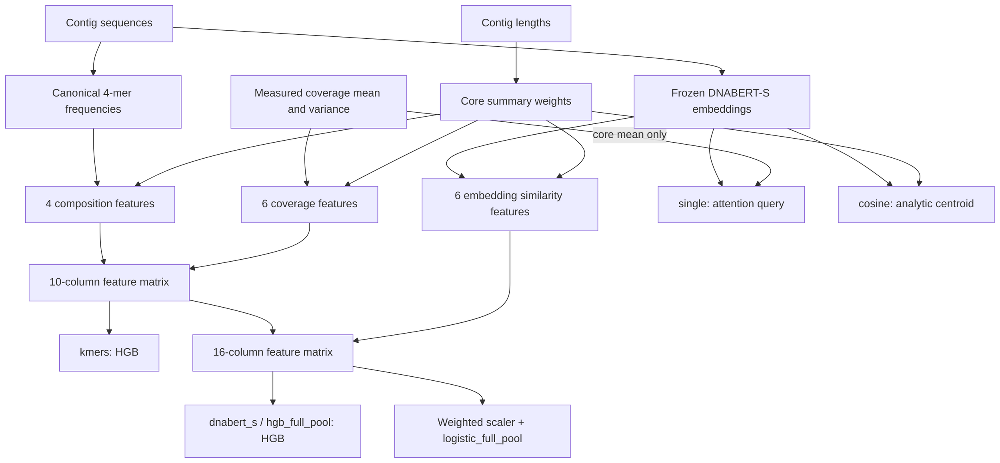
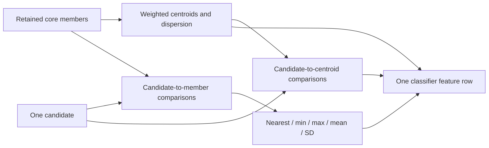
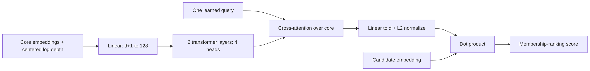

# Model features, formulas and scoring

This reference describes the six standard BinComplete profiles. It separates
input representations, classifier features, neural inputs and candidate filters.
Tables and formulas use the stored profile IDs. The preferred descriptive input
aliases are listed in [method naming](migration.md#method-names).
All summaries use the current **core**: the original retained members of a bin.
A candidate never contributes to its own core statistics. During masked training,
hidden positives are excluded from that core. Proposal search scores the original
core once; it does not refit or update the core after each proposed addition.

Start with [understanding the quantities](quantities.md) for reads, depth,
statistical spread, sequence similarities and model scores in ordinary language.
Every formula below refers to a measured input, a derived feature or a model
operation; none alone establishes biological membership or quality.

## Which inputs reach each model?

| Method | Scoring input | Feature columns | Candidate retrieval |
| --- | --- | --- | --- |
| `kmers` | Composition and coverage statistics | 4 + 6 = **10** | Composition Hellinger shortlist |
| `dnabert_s` | Composition, coverage and embedding statistics | 4 + 6 + 6 = **16** | Composition Hellinger shortlist |
| `hgb_full_pool` | Same 16 statistics | **16** | All eligible unassigned candidates |
| `logistic_full_pool` | Same 16 statistics, with a fitted weighted scaler | **16** | All eligible unassigned candidates |
| `single` | Core embeddings and one centered log-coverage value per core contig | A variable-size token set, not the engineered 16-column matrix | Learned-query shortlist |
| `cosine` | Candidate embedding and length-weighted core embedding centroid | One analytic similarity, no classifier fit | All eligible unassigned candidates |

`dnabert_s` and `hgb_full_pool` have the same feature definitions. Their retrieval,
masking and negative-sampling policies differ; their fitted estimators need not
produce the same ranking. `logistic_full_pool` changes the classifier and applies
training-only scaling. None of these features contains CheckM2, RNA annotations,
HQ status or accepted-repair labels.

## Notation and raw representations

A **core** is the nonempty set of retained original contigs used to score a
candidate. Write $C=\{1,\ldots,n\}$ after locally numbering its members; these
numbers are indices, not FASTA identifiers. The candidate $x$ is outside $C$.
In training, the core excludes the original members hidden by that episode's
mask. In proposal generation, the core is the whole original recipient bin.

| Symbol | Definition | Shape or units |
| --- | --- | --- |
| $i,j$ | Indices of core contigs; $x$ denotes the candidate instead | One contig |
| $n=\lvert C\rvert$ | Number of retained core contigs, not their total length | Positive integer |
| $L_i$ | Full sequence length of contig $i$ | Base pairs (bp) |
| $w_i$ | Fraction of the core's total length contributed by contig $i$ | Scalar, dimensionless |
| $p_i=(p_{i1},\ldots,p_{i136})$ | Canonical 4-mer frequency vector of contig $i$ | 136 nonnegative coordinates, summing approximately to 1 |
| $\mu_i$ | Mean mapped-read depth for contig $i$ in the **one selected coverage profile** | Scalar, depth (often written $\times$) |
| $v_i$ | Variance of position-wise depth within that same contig and profile | Scalar, squared depth units; $\sqrt{v_i}$ has depth units |
| $z_i$ | Frozen sequence embedding of contig $i$ | Vector in $\mathbb R^d$; $d$ is the recorded encoder dimension |

The same symbols with subscript $x$ describe the candidate. A subscript $C$
denotes a summary of the core, defined separately below. A bar denotes the mean
specified in that formula; some means are length-weighted and others are not.
$a^\top b=\sum_k a_kb_k$ is a dot product,
$\lVert a\rVert_2=\sqrt{\sum_k a_k^2}$ is the Euclidean norm, and $[a;b]$
means concatenation. $\ln$ is the natural logarithm.

Classifier summaries use **length weights**, not equal weights per contig:

$$
w_i=\frac{L_i}{\sum_{j\in C}L_j},\qquad \sum_{i\in C}w_i=1.
$$

For example, a 3,000-bp contig and a 1,000-bp contig receive weights $0.75$
and $0.25$. These weights are unrelated to the training-row weights used by
the classifiers, defined in [source balancing](training_protocol.md#source-balanced-classifier-weights).

### What exactly are mean depth and depth variance?

A **read** is a sequence reported by a sequencing machine from a DNA molecule
in the sample. After assembling contigs, mapping software aligns reads back to
them. At a position covered by 20 retained read alignments, depth is 20. Mean
depth 20x means that count averages 20 over the included positions. Read length
and depth are different quantities; depth has no general maximum of four.
The [DNA example](quantities.md#read-count-length-and-depth) shows the counting
and explains how physical reads arise and why they overlap.

Keep one read set, selected profile and upstream measurement policy fixed for
each reproducible input condition. Use that profile for every assembly contig,
including unassigned candidates. BinComplete reads the fixed aggregates; it
does not resample reads during masking, scoring or proposal search.

Let $B_i$ be the set of base positions included by the **upstream coverage tool**
for contig $i$, $M_i=|B_i|>0$, and $D_{ib}$ the mapped-read depth at included
position $b$. Depth describes coverage at a position, not the total number of
reads assigned to the whole contig. Under the population-moment convention:

$$
\mu_i=\frac{1}{M_i}\sum_{b\in B_i}D_{ib},\qquad
v_i^{\mathrm{pop}}=\frac{1}{M_i}\sum_{b\in B_i}(D_{ib}-\mu_i)^2.
$$

An upstream sample-variance estimate instead divides the squared deviations by
$M_i-1$ when $M_i>1$. **BinComplete does not estimate these moments from reads
or convert between variance conventions**: $\mu_i$ and $v_i$ are exactly the
paired aggregates read from the input table, before the configured dtype cast.
In a generic table they are `mean` and `variance`. In a multi-profile JGI table
they are the selected mean column and its adjacent `-var` column; `totalAvgDepth`
is not substituted for that selected mean.

The upstream tool determines $B_i$, end trimming, alignment-quality/identity
filters, read handling and whether zero-depth positions enter the aggregates.
A zero-depth position contributes $D_{ib}=0$ if it belongs to $B_i$; it must not
be silently discarded just because its depth is zero. Record the upstream
tool/version, profile and settings, and use the same measurement convention
for training and application. The table alone does not encode or verify all
those choices. See [coverage inputs](inputs.md).

For illustration, four included positions with depths $(0,2,2,4)$ have
$\mu_i=2$ and $v_i^{\mathrm{pop}}=2$. The variance measures unevenness **within
one contig**. It is neither variance across samples nor the spread of mean
depths across different core contigs. Two contigs can both have mean depth 10
while having different within-contig variances. Mean and variance must be finite
and nonnegative. A multi-sample abundance matrix alone cannot supply $v_i$.

### Canonical 4-mer coordinates

A 4-mer is an overlapping four-base window containing only A, C, G and T after
uppercasing the sequence; lowercase bases are accepted too.
For example, `AAAAA` contains two overlapping `AAAA` windows. Let $V_i$ contain
the valid window start positions on contig $i$. For a word $a_1a_2a_3a_4$,
encode bases as $0,1,2,3$ in the declared alphabet order and define

$$
\operatorname{code}(a_1a_2a_3a_4)=\sum_{t=1}^4\operatorname{index}(a_t)4^{4-t},
\qquad h(a)=\min(\operatorname{code}(a),\operatorname{code}(\operatorname{revcomp}(a))).
$$

Sort the distinct values of $h$ numerically. Their zero-based positions are the
table columns `0` through `135`; the mathematical subscript $k$ below is one-based.
This defines both supported `ACGT` and `ATGC` bases without relying on a language's
string sort order. There are 256 possible words and 16 reverse-complement
palindromes, giving $(256+16)/2=136$ classes. `AAAA` and `TTTT` share a class;
the palindrome `ACGT` belongs to one class and is counted once per window.

If $\kappa(a)\in\{1,\ldots,136\}$ is that class position plus one, the count and initial frequency are

$$
N_{ik}=\sum_{b\in V_i}\mathbf1\{\kappa(a_{ib})=k\},\qquad
p_{ik}=\frac{N_{ik}+\alpha}{\sum_{r=1}^{136}(N_{ir}+\alpha)}
       =\frac{N_{ik}+\alpha}{|V_i|+136\alpha}.
$$

$\mathbf1$ is 1 when the stated condition holds and 0 otherwise; $a_{ib}$ is
the four-base word starting at $b$. Windows containing other characters are
excluded. The standard profile uses the `ATGC` basis, $\alpha=10^{-5}$,
float32 storage and an additional float32 sequential-sum normalization. With no
valid windows and positive $\alpha$, the initial distribution is uniform; with
zero pseudocount and no valid windows, composition computation raises an error.

Supplied numeric columns must already use the coordinate mapping implied by the
method's declared alphabet order. BinComplete aligns column headers and normalizes
values in bounded blocks; it does not infer or convert their alphabet basis.
The pseudocount is not added again. These are 136
representation coordinates, **not 136 classifier columns**.

Embeddings come from an explicitly supplied normalized array or the frozen local
DNABERT-S encoder. Dimension and encoder/tokenizer/pooling identities must match.

### From DNA tokens to one contig embedding

A **DNA token** is an input symbol produced by the declared tokenizer from a
sequence. Its vocabulary and segmentation determine which bases it represents;
tokens need not be fixed-length k-mers or single bases. **Special tokens** are
tokenizer-defined symbols, such as sequence-boundary markers, rather than
observed DNA. Padding fills unused batch positions. The encoder returns one
hidden vector per token position, including those extra positions.

The standard `non_special_bp_weighted_windows` recipe makes a contig vector in
this order:

1. Select up to four windows of at most 6,000 bp. For contig length $L$, their
   zero-based starts are the unique values
   $\lfloor j\max(0,L-6000)/3\rfloor$ for $j=0,1,2,3$. Thus a contig of at
   most 6,000 bp supplies one window. Longer contigs can have overlapping windows.
2. Use each window's forward sequence and its reverse complement. Tokenize each
   orientation with special tokens included. If it exceeds `max_tokens=2048`,
   split its base string at $\lfloor\operatorname{len}(s)/2\rfloor$ and
   recursively retokenize both halves until every piece fits. No tokens are
   truncated. The limit counts special tokens as well as DNA tokens; if even one
   base cannot fit, encoding fails. The two orientations can split differently.
3. Encode every piece, then average its token vectors after excluding padding
   and every token ID listed as special by the tokenizer.
4. Combine all piece vectors from all selected windows and both orientations in
   **one length-weighted mean**, then L2-normalize that result. Store the standard
   vector as float16 after normalization.

More precisely, let $\mathcal R$ index all those pieces for one contig, $s_r$
be piece $r$'s base string, $\lambda_r=\operatorname{len}(s_r)$ its length in
bp, $T_r$ its non-padding, non-special token positions and $h_{rt}\in\mathbb R^d$
the encoder's hidden vector at position $t$. The piece mean $u_r$, pooled vector
$a$ and final embedding $z$ are

$$
u_r=\frac{\sum_{t\in T_r}h_{rt}}{\max(|T_r|,1)},\qquad
a=\frac{\sum_{r\in\mathcal R}\lambda_r u_r}
        {\sum_{r\in\mathcal R}\lambda_r},\qquad
z=\frac{a}{\lVert a\rVert_2}.
$$

Token positions receive equal weight within a piece; the **piece mean** then
receives the base-pair weight. Piece vectors are not normalized before that
weighted mean. The denominator counts every piece on every orientation, so each
window contributes its length twice. Overlapping window bases contribute again
in each window: this is pooling of sampled windows, not unique-base weighting
over the whole contig. A nonfinite result or norm at most $10^{-12}$ is rejected.

For a toy two-coordinate example, suppose one 6,000-bp window splits into
3,000-, 1,500- and 1,500-bp pieces on each orientation, with respective piece
means $(2,0)$, $(0,2)$ and $(0,4)$ on both orientations. The six piece weights
sum to 12,000 bp, giving

$$
\begin{aligned}
a &= \tfrac12(2,0)+\tfrac14(0,2)\\
  &\quad+\tfrac14(0,4)=(1,1.5)
\end{aligned}
$$

and $z=(2,3)/\sqrt{13}$. The 2,048-token limit decides whether splitting is needed;
it does not set these base-pair weights.

The low-level legacy `masked_mean_uniform_windows` protocol has a different
contract: it uses forward windows only, truncates tokenizations at `max_tokens`,
averages all attention-mask positions (including special tokens), gives each
window equal weight, and then L2-normalizes. Its low-level defaults include
`max_tokens=512` and float32 storage. It is distinct from the standard recipe
above; the recorded pooling identity matters when comparing embeddings.
Device, precision and batch layout are recorded separately. See
[input contracts](inputs.md) and [numerical reproducibility](validation.md).

## Composition: four features

Define the length-weighted frequency centroid and Hellinger distance:

$$
\bar p_C=\sum_{i\in C}w_i p_i,\qquad
H(p,q)=\sqrt{\max\left(\frac12\sum_k(\sqrt{p_k}-\sqrt{q_k})^2,0\right)}.
$$

| Saved statistic | Formula | Meaning |
| --- | --- | --- |
| `composition_hellinger` | $H(p_x,\bar p_C)$ | Candidate distance to the whole-core composition centroid |
| `composition_min_hellinger` | $\min_{i\in C}H(p_x,p_i)$ | Candidate distance to its closest core member |
| `composition_cosine_distance` | $1-\frac{p_x^\top\bar p_C}{\max(\lVert p_x\rVert_2\lVert\bar p_C\rVert_2,10^{-12})}$ | Difference in frequency-vector direction |
| `core_composition_dispersion` | $\sum_{i\in C}w_iH(p_i,\bar p_C)$ | Core context: weighted mean distance to its own centroid |

For normalized frequency distributions, Hellinger distance is 0 for identical
composition and at most 1; it is not a membership probability. A centroid is
an average frequency vector, while the nearest-member statistic asks whether
the candidate resembles at least one individual member. See
[composition intuition](quantities.md#sequence-composition-and-distances).

Smaller distances indicate closer composition, but the classifier learns how
they affect its score. Dispersion is the same for every candidate of one core;
it supplies context rather than candidate-specific evidence. This dispersion is
a mean Hellinger distance, not a standard deviation of the frequency coordinates.

The following overview spans all three feature blocks; the reductions used
by each block are exactly those in its own table.

## Coverage: six features

Use the measured $\mu_i$ and $v_i$ defined above. Natural logarithms reduce
the scale of depth differences. The fixed offset $\epsilon_\mu=0.1$ is added
in depth units so that zero depth has a finite logarithm:

$$
\ell_i=\ln(\mu_i+0.1),\qquad
m_C=\sum_{i\in C}w_i\ell_i,\qquad
s_C=\sqrt{\sum_{i\in C}w_i(\ell_i-m_C)^2}.
$$

$\ell_i$ is one contig's log depth. $m_C$ is its length-weighted core mean,
and $s_C$ is the weighted population standard deviation of those log depths.
Neither $s_C$ nor $s_C^2$ is the measured within-contig variance $v_i$.

Define the candidate difference and transformed within-contig variability:

$$
\delta_x=\ell_x-m_C,\qquad
r_i=\ln\left(1+\frac{\sqrt{v_i}}{\mu_i+0.1}\right),\qquad
\bar r_C=\sum_{i\in C}w_i r_i.
$$

$\delta_x$ compares the candidate with the core. $r_i$ is the natural log
of one plus an offset-adjusted coefficient of variation, and $\bar r_C$ is
its length-weighted core mean. For example, $\mu_i=10$ and $v_i=25$ give
$r_i=\ln(1+5/10.1)$; constant depth has $v_i=0$ and $r_i=0$.

| Saved statistic | Formula | Meaning |
| --- | --- | --- |
| `log_coverage_difference` | $\delta_x$ | Signed deviation; positive means greater candidate log depth |
| `abs_log_coverage_difference` | $\lvert\delta_x\rvert$ | Magnitude of the deviation |
| `min_abs_log_coverage_difference` | $\min_{i\in C}\lvert\ell_x-\ell_i\rvert$ | Closest individual core depth |
| `core_log_coverage_dispersion` | $s_C$ | Core context: weighted population standard deviation in log depth |
| `standardized_coverage_difference` | $\lvert\delta_x\rvert/\max(s_C,0.35)$ | Deviation relative to core spread, with a fixed denominator floor |
| `coverage_cv_difference` | $\lvert r_x-\bar r_C\rvert$ | Difference in transformed within-contig coverage variability |

The last feature uses **log1p-transformed, offset-adjusted CV**, not the absolute
difference between two raw coefficients of variation. Zero measured variance is
valid. Missing variance cannot be fabricated and is rejected by the four
feature-classifier profiles. Core spread uses the population convention; there
is no sample-size correction.

## Embedding similarity: six features

For stored, approximately unit-length embeddings, define

$$
c_C=\sum_{i\in C}w_i z_i,\qquad
\hat c_C=\frac{c_C}{\max(\lVert c_C\rVert_2,10^{-12})},\qquad
t_{xi}=z_x^\top z_i,\qquad
\bar t_x=\frac1n\sum_{i\in C}t_{xi}.
$$

| Saved statistic | Formula | Meaning |
| --- | --- | --- |
| `dna_center_similarity` | $z_x^\top\hat c_C$ | Similarity to the normalized, length-weighted core centroid |
| `dna_max_similarity` | $\max_{i\in C}t_{xi}$ | Most similar core member |
| `dna_min_similarity` | $\min_{i\in C}t_{xi}$ | Least similar core member |
| `dna_mean_similarity` | $\bar t_x$ | Unweighted mean similarity across core members |
| `dna_std_similarity` | $\sqrt{\max(\frac1n\sum_i t_{xi}^2-\bar t_x^2,0)}$ | Unweighted population SD of member similarities |
| `dna_weighted_similarity` | $\sum_{i\in C}w_i t_{xi}$ | Length-weighted mean member similarity |

An embedding is a learned sequence representation; its coordinates are not
individual gene counts or named biological measurements. For unit vectors,
cosine similarity 1 means the same direction, 0 means perpendicular and -1 means
opposite. Similarity 0.9 does not mean 90% nucleotide identity. See
[embedding examples](quantities.md#embeddings-similarities-and-neural-inputs).

The ordinary mean and SD are unweighted; the centroid and final mean use length
weights. Centroid similarity and weighted mean similarity are related but differ
because only the centroid is renormalized. These six statistics use stored-vector
dot products: they do **not** silently renormalize every stored vector. Float16
quantization can therefore produce small deviations from ideal cosine values.

## Feature matrix order, precision and classifiers

A **component ID** selects a feature implementation; a **configured block key**
names that instance in the saved schema. They are distinct:

| Configured block key / schema prefix | Registered component ID |
| --- | --- |
| `composition` | `composition_distances` |
| `coverage` | `coverage_agreement` |
| `embedding` | `embedding_similarities` |

FeatureComposer sorts the configured keys alphabetically: `composition`, then
`coverage`, then `embedding`. Within a block, columns follow its table above.
For example, the saved column name is `coverage.log_coverage_difference`;
`coverage_agreement` is its implementation ID, not its schema prefix.

Thus `kmers` has the four composition columns followed by six coverage columns;
the three 16-feature methods append the six embedding columns. Model
`summary.json` records the actual `feature_schema`; inspect it when using a custom
configuration. Individual statistics can be selected/reordered at the component
level, but the six standard profiles use every statistic in each selected block.

Classifier rows are float32. Composition and coverage calculations use float64
intermediates after reading the configured representation; the standard raw
coverage representation has already been cast to float32. Embedding pair products
use float32, while several member reductions use float64. The centroid has an
explicit float32 cast. Preserving only algebraic formulas does not promise
bitwise equality after changing dtypes, reduction order or devices.

For one core/candidate pair, concatenate the selected feature columns into
$f(x,C)\in\mathbb R^F$, with $F=10$ for `kmers` and $F=16$ for the other
feature classifiers. This is one classifier row, not a representation of an
entire proposed bin.

For HGB, $h_t$ is learned tree $t$'s raw log-odds contribution, $T$ is the
number of boosting iterations, $b$ is the initial raw score and $\eta$ is the
learning rate. The sigmoid $\sigma$ maps the final raw score to the positive class:

$$
s_{\mathrm{HGB}}(x,C)=\sigma\left(b+\eta\sum_{t=1}^{T}h_t(f(x,C))\right),
\qquad \sigma(a)=\frac1{1+e^{-a}}.
$$

The standard HGB classifier uses 150 iterations, at most 7 leaves, learning rate
0.05, minimum 30 samples per leaf and L2 regularization 2.0, without early stopping.
It receives the engineered rows directly; there is no StandardScaler before HGB.

Logistic regression fits a source-weighted StandardScaler **on training rows only**.
Let $\mathcal T$ index those rows, $a_r$ be row $r$'s positive training weight
and $f_{rk}$ be its value in feature column $k$. These $a_r$ weights balance
source bins and present label classes; they are **not** the length weights $w_i$.
Their exact definition is in [source balancing](training_protocol.md#source-balanced-classifier-weights).

$$
m_k=\frac{\sum_{r\in\mathcal T}a_r f_{rk}}{\sum_{r\in\mathcal T}a_r},\qquad
q_k^2=\frac{\sum_{r\in\mathcal T}a_r(f_{rk}-m_k)^2}{\sum_{r\in\mathcal T}a_r},\qquad
\widetilde f_k(x,C)=\frac{f_k(x,C)-m_k}{A_k},\qquad
s_{\mathrm{LR}}(x,C)=\sigma(\beta_0+\beta^\top\widetilde f(x,C)).
$$

$m_k$ is the training mean of feature $k$, $q_k$ its weighted population
standard deviation, and $A_k$ the saved scaler's `scale_`. The usual nonconstant
case has $A_k=q_k$; scikit-learn handles constant/nearly constant columns safely.
$\widetilde f\in\mathbb R^F$ is the standardized row, $\beta\in\mathbb R^F$
the fitted coefficient vector and $\beta_0$ the intercept. The fitted scaler and
coefficients are reused unchanged at inference; candidate data do not refit them.

The standard logistic profile uses L2 regularization, `C=1` (inverse
regularization strength), `lbfgs`, `max_iter=1000`, `tol=1e-6` and seed 73019.
Both classifier families use source-balanced training weights. Their positive-class
probabilities are membership-ranking scores; they are not calibrated probabilities
of an HQ genome or a correct whole bin.

## Attention inputs and the `single` model

For each core contig, the attention model concatenates its embedding with one
**unweighted, core-centered** log-depth value:

$$
u_i=\left[z_i;\ \ln(\mu_i+0.1)-\frac1n\sum_{j\in C}\ln(\mu_j+0.1)\right].
$$

$u_i\in\mathbb R^{d+1}$ is one attention token: $d$ embedding coordinates
followed by one scalar centered log depth. Stack tokens as rows in
$U_C=[u_1^\top;\ldots;u_n^\top]\in\mathbb R^{n\times(d+1)}$.
Unlike classifier summaries, this centering does not use length weights. The
network receives neither coverage variance nor the engineered feature matrix.
Contig length is not a token input. A linear projection maps $d+1$ inputs to width
128, followed by two transformer encoder layers (4 heads, feedforward width 256,
dropout 0). Within each layer, the feedforward subnetwork expands each row from
128 to **256 internal coordinates**, applies its activation, and maps back to
128. This feedforward width is separate from embedding dimension $d$, classifier
feature count and the number of core contigs. **Dropout** is the training-time
rate of randomly omitting activations or attention weights at dropout operations;
0 disables it. One learned query attends to the encoded core, projects back to
$d$ and is L2-normalized:

Here $H_C\in\mathbb R^{n\times128}$ contains one encoded row per core
contig. $q_0\in\mathbb R^{1\times128}$ is a learned parameter shared across
all bins; it is not a separately fitted parameter for each recipient. Attention
uses it to form a core-dependent output $q_C\in\mathbb R^d$. The two `Linear`
operators are different learned affine maps, of widths $d+1\to128$ and
$128\to d$. Normalization divides the output vector by
$\max(\lVert\cdot\rVert_2,10^{-12})$.

$$
H_C=\operatorname{Transformer}(\operatorname{Linear}(U_C)),\qquad
q_C=\operatorname{normalize}\left(\operatorname{Linear}
    (\operatorname{MultiheadAttention}(q_0,H_C,H_C))\right),\qquad
s_{\mathrm{single}}(x,C)=z_x^\top q_C.
$$

Candidate coverage affects eligibility, but is not concatenated to the candidate
embedding at scoring. There are no positional encodings. Training uses the
completion objective with temperature 0.1; inference uses the raw dot product
without dividing by temperature. The loss and its candidate denominator are
defined in the [training protocol](training_protocol.md#attention-completion-loss).
Epoch selection uses source-averaged, pessimistic-tie holdout recall at 5, followed
by a full-source refit; the [selection rule](training_protocol.md#attention-epoch-selection)
defines the masks, averaging and stopping criterion.

## Analytic cosine model

Cosine uses the same length-weighted embedding centroid, with explicit candidate
and centroid normalization:

$$
s_{\mathrm{cosine}}(x,C)=
\left(\frac{z_x}{\max(\lVert z_x\rVert_2,10^{-12})}\right)^\top
\left(\frac{\sum_iw_i z_i}{\max(\lVert\sum_iw_i z_i\rVert_2,10^{-12})}\right).
$$

It fits no membership classifier. Coverage is used for eligibility, not added to
this score. There is no learned combination of the four composition, six coverage
or six embedding-statistic features in this method.

## Filters, retrieval and search are separate from model features

All supplied original bin members are protected. The default pool is unassigned
assembly contigs, optionally restricted by donor IDs. Under standard settings a
candidate must satisfy

$$
2000\le L_x\le\sum_{i\in C}L_i,\qquad
\left|\ln(\mu_x+0.1)-\sum_iw_i\ln(\mu_i+0.1)\right|\le\ln4.
$$

Equivalently, let $G_C=\exp(m_C)$ be the length-weighted geometric mean of
the offset-adjusted core depths. The depth condition is
$G_C/4\le\mu_x+0.1\le4G_C$: the factor of four applies **after** adding 0.1,
not to an arithmetic mean of raw depths. This distinction matters near zero.

The two shortlist HGB methods keep up to 1,000 candidates by Hellinger distance
to the length-weighted composition centroid. Attention retrieves up to 1,000 by
normalized query/candidate similarity, then scores using the stored candidate
embedding's raw dot product with the query. Float16 norm deviations can make
those two numerical operations slightly different. Full-pool HGB, logistic and
cosine score every eligible candidate. Ties are resolved by contig ID.

The standard search uses a cap of 128 proposals, singleton depth 50, boundary
width 2 and total added length at most the original core length. It visits the
following donor-rank templates in order (ranks start at 1):

1. The original 20 templates: `{1}`, `{2}`, `{3}`, `{4}`, `{5}`, `{1,2}`,
   `{1,3}`, `{2,3}`, `{1,2,3}`, `{1,2,3,4,5}`, `{1,4}`, `{1,5}`, `{2,4}`,
   `{2,5}`, `{3,4}`, `{3,5}`, `{4,5}`, `{2,3,4}`, `{1,...,10}`, `{1,...,20}`.
   If fewer than 20 valid constructions are produced, singleton ranks 6 through
   50 are considered in order until that first-stage cap is reached.
2. Singleton ranks 1 through 50, skipping full memberships already emitted.
3. Prefix substitutions for size 10 and then 20. For each incoming rank 11 then
   12 (or 21 then 22), remove each prefix rank in descending order. For example,
   the first size-10 substitution replaces donor rank 10 with rank 11, giving
   `{1,...,9,11}`; the next replaces rank 9, giving `{1,...,8,10,11}`.

A template needing an unavailable rank is skipped rather than shortened. A
construction exceeding the added-length cap is skipped; full memberships are
deduplicated, and emission stops at 128. For example, `{6}` emitted as an early
fallback is not emitted again in the singleton stage. The original core is
included in every construction and never removed. These search rules consume
rankings; they are not additional classifier columns.
Scoring a proposal does not establish its biological quality. Follow
[external assessment and compatible export](evaluation.md).

## Implementation pointers

Current implementations use descriptive names. The feature module is
[`features/membership.py`](https://github.com/Ludvins/BinComplete/blob/main/src/bincomplete/features/membership.py), and the
three registered block names are given above. Recipes use those descriptive
component IDs. Keep dataset-specific recipes and their original source snapshots
with the project that produced them.

The six profiles do not append separate contig-length/count feature columns.
Length still affects summary weights, eligibility, masking and search. Extra
columns in upstream tables must not be assumed to be active model inputs.

Formula definitions: [membership features](https://github.com/Ludvins/BinComplete/blob/main/src/bincomplete/features/membership.py).
Column order: [FeatureComposer](https://github.com/Ludvins/BinComplete/blob/main/src/bincomplete/features/composer.py).
Model mapping: [method recipes](https://github.com/Ludvins/BinComplete/blob/main/src/bincomplete/methods.py).
Scoring: [feature classifier](https://github.com/Ludvins/BinComplete/blob/main/src/bincomplete/scorers/vector.py),
[weighted logistic](https://github.com/Ludvins/BinComplete/blob/main/src/bincomplete/classifiers/logistic.py),
[attention network](https://github.com/Ludvins/BinComplete/blob/main/src/bincomplete/scorers/set_network.py),
[attention inputs](https://github.com/Ludvins/BinComplete/blob/main/src/bincomplete/scorers/sets.py) and
[cosine centroid](https://github.com/Ludvins/BinComplete/blob/main/src/bincomplete/scorers/centroid.py).

These diagrams use Mermaid and formulas use GitHub Markdown math. Plain-text
viewers still expose their source. Saved models retain their original numerical
source identity: source renaming does not authorize bypassing compatibility
checks. Use the original frozen package for exact replay of an older artifact;
use a new output directory for newly fitted models. See [migration](migration.md).
