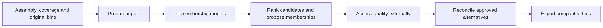

# BinComplete

**Membership-guided contig recruitment for metagenomic bin refinement.**

BinComplete takes an assembly, measured coverage and the original bins from an
existing binner. It uses original memberships to learn which unassigned contigs
fit each recipient bin, then generates ranked alternatives that preserve the
recipient's original sequences. Six standard methods provide complementary
rankings, including an analytic cosine method that needs no classifier training.

Start with [installation and a first run](from_scratch.md). The included demo
tests the installation using artificial data without downloading model weights:

```shell
bincomplete demo --output demo
```

## Choose your workflow

| You want to… | Start here |
| --- | --- |
| Install the package and run a complete example | [Installation and first run](from_scratch.md) |
| Use MMLong2 outputs | [Input formats and the MMLong2 adapter](inputs.md#mmlong2-handoff) |
| Use bins from another tool | [Generic binner workflow](generic_workflow.md) |
| Set encoder paths, devices and resource limits | [Shared configuration](global_configuration.md) |
| Interpret scores, priorities and proposal files | [Outputs, ranking and external evaluation](evaluation.md) |
| Understand depth, features and model formulas | [Quantities](quantities.md) and [features](features.md) |

## From original bins to reviewed refinements



Proposal scores describe agreement with the original membership signal. They are
not HQ probabilities or estimates of completeness and contamination. Quality
assessment, including any required RNA checks, remains external. The default
assessment order preserves every proposal; a lab chooses its assessment budget.
Read the [evaluation workflow](evaluation.md) before accepting refinements.

## Scientific scope

BinComplete is a research beta. It protects original bin members and records
input, model and output identities. When the same dataset supplies training and
recipient bins, the use is transductive: results do not establish performance on
an independent metagenome. Read the [training protocol](training_protocol.md) and
[validation limits](validation.md) when designing a study.

## Project and support

Author and maintainer: **Luis A. Ortega**, [laoa@cs.aau.dk](mailto:laoa@cs.aau.dk).
Source, issue reporting and licence notices are in the
[BinComplete repository](https://github.com/Ludvins/BinComplete). BinComplete uses
the MIT licence; external models retain their upstream licences.
