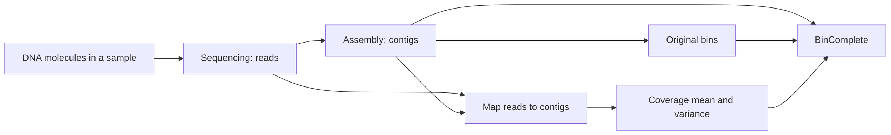

# Understanding the quantities

This guide explains what the inputs, features, scores and settings mean in
ordinary language. All examples are invented to explain a calculation; they
are not sequencing results or recommended quality thresholds. The
[feature reference](features.md) gives the exact formulas and model mapping;
the [training protocol](training_protocol.md) defines sampling and optimization.

## From a DNA sample to reads and contigs

A DNA sample contains physical molecules from the organisms in that sample,
often including many copies of the same genomic regions. A sequencing machine
reports base sequences from those molecules. Each reported sequence is a
**read**. Library preparation and sequencing technology affect which molecules
are sequenced and their lengths; some protocols fragment or size-select DNA.
Read sampling and measurement can introduce biases.

Reads are observations produced before an assembly exists. Assembly software
uses their sequence relationships to reconstruct longer sequences called
**contigs**. Binning software groups contigs thought to come from the same genome.
To measure depth, mapping software aligns reads back to the assembly, and a
coverage tool summarizes the retained alignments. Ambiguous alignments, quality
filters and trimmed contig ends depend on that upstream tool's policy.



BinComplete starts from the contigs, original bin memberships and coverage
table. It does not generate reads, choose how many molecules to sequence,
assemble the reads or run a read mapper.

## Read count, length and depth

**Read count** is how many reads the sequencer reported. **Read length** is the
number of bases in one read. **Contig length**, $L_i$, is the number of bases
in an assembled contig. All three describe different quantities.

Here are three invented, four-base read alignments on an eight-base contig:

```text
Position:  1 2 3 4 5 6 7 8
Contig:    A C G T A C G T

Read 1:    A C G T
Read 2:        G T A C
Read 3:            A C G T

Depth:     1 1 2 2 2 2 1 1
```

The read sequences, lengths and start positions were chosen solely for this
illustration. Their placements are assumed here; a real mapper must infer
alignments, including handling repeated sequences. Real reads need not have
equal lengths or these start positions.

At position 3, two reads cover the G, so its depth is **2**. The mean over these
eight positions is

$$
\frac{1+1+2+2+2+2+1+1}{8}=1.5,
$$

written **1.5x** or $1.5\times$.
The read count is 3, each read length is 4 bp, the contig length is 8 bp, and
the maximum position-wise depth is 2. Depth has no general limit of 4: if
100 retained read alignments cover a position, its depth is 100.

### Which reads must stay the same?

For one reproducible dataset analysis, keep the read set, assembly, selected
coverage profile and mapping/coverage settings fixed. Measure every contig,
including unassigned candidates, under that same profile and policy. BinComplete
reuses the resulting table; it never draws new reads per candidate or episode.
Hiding a member during training changes the core, not its measured depth.

Independent samples or sequencing runs can have different reads and depths.
Sampling variation does not make depth meaningless, but it makes it an uncertain
measurement rather than an exact organism identifier. Contigs from the same
organism often have similar depth in the same sample. Other organisms can have
similar abundance, and repeats, copy number and measurement bias can disrupt
that pattern. Similar depth is useful evidence alongside sequence features.

Changing reads, assembly, profile or coverage processing creates a new input
condition. Preserve the original table and upstream provenance for reruns, use
a new output directory for changed inputs, and assess cross-dataset behavior
separately. BinComplete's table hashes establish which aggregates were supplied;
they do not reconstruct or independently validate the raw read-mapping process.

### Mean, variance, standard deviation and CV

The exact [coverage formulas](features.md#what-exactly-are-mean-depth-and-depth-variance)
use the upstream tool's included positions and variance convention.

| Quantity | Plain meaning | Example and interpretation |
| --- | --- | --- |
| Mean depth, $\mu_i$ | Average number of retained read alignments covering an included base of contig $i$ | 20x means about 20 alignments per included position on average, not necessarily exactly 20 at every position. |
| Within-contig depth variance, $v_i$ | Average squared deviation of position-wise depths from their mean, under the population convention | Depths $(2,2,2,2)$ have mean 2 and variance 0; $(0,0,4,4)$ have the same mean and variance 4. Larger values mean more uneven depth within that contig. |
| Standard deviation, $\sqrt{v_i}$ | Spread expressed back in depth units | Variance 4 has SD 2. A variance input must not be replaced by its SD. |
| Coefficient of variation (CV) | SD divided by mean: unevenness relative to typical depth | Mean 10 and SD 5 give raw CV 0.5, or 50%. BinComplete uses an offset and logarithm, $\ln(1+\sqrt{v_i}/(\mu_i+0.1))$, rather than this raw ratio. |

Depth and the fraction of positions covered are also distinct. A contig with
depth 1 at every included position and one with depth 20 everywhere both have
100% covered positions. The standard features use depth mean and variance;
they do not add a separate covered-position fraction feature.

## Sequence composition and distances

A **4-mer** is a four-base word in a sequence. `AAAAA` has two overlapping
`AAAA` windows. A **count** records how often a word occurs; a **frequency**
divides by the total, so contigs of different lengths can be compared.
For example, a class observed 20 times among 100 valid windows has frequency
0.2 before pseudocount smoothing.

Canonical composition combines a word with its reverse complement, such as
`AAAA` with `TTTT`, so strand direction does not create separate coordinates.
This gives 136 frequency coordinates for 4-mers. A **pseudocount** adds a small
amount to every count before normalization, avoiding exact zeros. It does not
represent an observed read or DNA base. See the
[coordinate and pseudocount formulas](features.md#canonical-4-mer-coordinates).

A **centroid** is an average vector describing the core. Length weighting gives
longer contigs more influence: 3,000 bp and 1,000 bp receive weights 0.75 and
0.25. If their mean depths are 10 and 20, their weighted arithmetic mean is
12.5 rather than the equal-contig mean 15. Coverage features actually average
log depths, so this arithmetic example explains weighting, not their final formula.

**Hellinger distance** measures differences between frequency distributions.
It is 0 for identical distributions and at most 1 for exactly normalized
nonnegative distributions. In a two-coordinate illustration, $(1,0)$ and
$(0,1)$ have distance 1. Smaller values mean more similar composition; a
distance of 0.2 is not a 20% probability of wrong membership.

The **nearest-member distance** asks whether the candidate resembles at least
one core contig. The **centroid distance** compares it with the core as a whole.
**Core dispersion** measures how different the core members are from their
own centroid. A dispersed core supplies less uniform context, but dispersion
alone cannot diagnose contamination. The feature tables specify which spread
is a mean distance and which is a standard deviation.

## Embeddings, similarities and neural inputs

An **embedding** is a numerical vector produced from a contig sequence by the
declared encoder. Its dimension $d$ is the number of coordinates. Individual
coordinates are learned representations, not named biological quantities such
as GC content or numbers of genes. A larger dimension does not itself mean a
more accurate genome assignment.

**DNA tokens** are symbols produced from bases by the encoder's tokenizer;
their lengths depend on its vocabulary and segmentation, so they need not be
fixed-length k-mers. **Special tokens**, such as sequence-boundary markers, are
added by the tokenizer. Padding fills unused batch positions.

**Pooling** combines vectors into one contig vector. The standard recipe samples
up to four 6,000-bp windows and uses both orientations of each. Each encoded piece
must fit 2,048 tokens **including special tokens**; an oversized orientation is
recursively split in base space and retokenized, preserving every piece. Each
piece's vector is the mean of its DNA token vectors, excluding special tokens
and padding. Those piece vectors are averaged together across all windows and
orientations with weights equal to their piece lengths in bp. The denominator
is the sum of all those piece lengths. Overlapping window bases count each time
they occur in a selected window. The result is L2-normalized once at the end,
then stored in float16. The
[pooling formulas and weighted-piece example](features.md#from-dna-tokens-to-one-contig-embedding)
also distinguish the low-level legacy encoder protocol.

**L2 normalization** divides a vector by its Euclidean length. For example,
$(3,4)$ becomes $(0.6,0.8)$. Its direction is preserved and its norm becomes 1.

For exactly unit vectors, a **dot product** equals cosine similarity: 1 for the
same direction, 0 for perpendicular directions, and -1 for opposite directions.
Higher similarity means closer direction in that encoder space; 0.9 is not
90% nucleotide identity or a 90% probability of correct membership. Stored
quantized vectors need not have exactly unit norm; the
[feature reference](features.md#embedding-similarity-six-features) specifies
which operations explicitly normalize them.

Minimum and maximum similarity describe the least and most similar core members.
The mean describes overall agreement, and its SD describes how uneven that
agreement is. For member similarities $(0.2,0.8)$, the unweighted mean is 0.5
and population SD is 0.3. Length weighting can change the mean.

The attention model treats each core contig's vector plus centered log depth as
one **token**. A learned **query** summarizes that core to score candidates.
Attention weights determine how information is combined; they are not biological
membership probabilities. In this network, width is the hidden coordinate count,
layers are successive transformations, and heads are parallel attention
computations. The standard width 128 and four heads do not mean 128 contigs or
four organisms. The [attention diagram](features.md#attention-inputs-and-the-single-model)
shows their roles. An encoder's DNA sequence tokens are a different kind of
token from these contig-level attention inputs.

## Transforms and standardized differences

**Logarithms** express multiplicative differences on an additive scale.
BinComplete uses $\ell_i=\ln(\mu_i+0.1)$; the 0.1 offset makes zero-depth
values finite. If two offset-adjusted depths are 10 and 20, their log difference
is $\ln(20/10)=\ln2\approx0.693$. A positive candidate-minus-core difference
means higher depth; its absolute value describes the size of the mismatch.

The core's mean log depth, $m_C$, corresponds to an offset-adjusted geometric
mean $G_C=\exp(m_C)$. For equally weighted offset depths 10 and 40, $G_C=20$;
their arithmetic mean is 25. The core spread $s_C$ describes differences
**between contigs' log means**. It is distinct from $v_i$, which describes
position-wise variation **within one contig**.

A **standardized coverage difference** divides the absolute log mismatch by
$\max(s_C,0.35)$. If the mismatch is 0.7 and the core spread is 0.2, the result
is $0.7/0.35=2$. The floor avoids division by zero or an extremely small spread.
This statistic is not a p-value, confidence level or universal rejection rule.

The logistic classifier also **standardizes feature columns** using its saved
training mean and SD. If a feature's training mean is 10, its scale is 2 and its
current value is 14, its standardized value is $(14-10)/2=2$. This puts feature
scales on comparable numerical footing; it does not make their biological
importance equal. The fitted scaler is reused unchanged during application.

## Labels, scores and training metrics

| Quantity | Meaning and interpretation |
| --- | --- |
| Positive / negative label | Proxy membership label 1 / 0, derived from original bins and related-group exclusions. It is not an HQ verdict. |
| Hidden count / fraction | Number / proportion of original members withheld to simulate missing members. A length fraction of 0.1 targets 10% of source bases, not necessarily 10% of its contig count. |
| Hard negative | A known negative that resembles the core under the sampler's similarity rule. Hardness does not mean independently proven biological unrelatedness. |
| Training weight | A row's contribution to the fitted objective. Source balancing prevents a source from dominating simply by providing more rows. It differs from length weights in feature summaries. |
| Membership score | A model's ranking value for one candidate and core. Higher values rank earlier within that method/core. Scores from different methods or recipients are not a common calibrated quality scale. |
| Mean added score | Arithmetic mean of the saved membership scores of a proposal's added contigs against the original core. It is a heuristic summary, not a quality prediction for the combined genome. |
| Assessment priority | A scheduling position obtained by balancing high-mean-score proposals across different numbers of added contigs. All proposals receive a rank and remain available; the first-tier boundary does not remove later proposals. |
| Logistic coefficient | A fitted contribution to raw log odds per standardized feature unit, conditional on the other features. Its sign describes model behavior, not a causal biological effect. |
| Training loss | The numerical objective minimized during fitting. Lower loss means better fit to that objective on those examples; it does not establish better genome quality. |
| Recall at 5 | Fraction of hidden true members ranked within the first five positions, with the documented pessimistic tie rule. Recovering two of three gives $2/3$. This is attention's selection metric. |

HGB and logistic scores lie between 0 and 1 through their classifier link,
but are not calibrated correctness or HQ probabilities. The **sigmoid** maps
raw score $a$ to $1/(1+e^{-a})$; $a=0$ maps to 0.5. The raw score is on a
log-odds scale. A logistic coefficient of 1 adds one to raw log odds for a
one-unit increase in that standardized feature, holding the others fixed.

Attention uses a candidate softmax during training. Its **temperature** divides
scores before that softmax: a lower positive temperature makes differences
sharper. With a score gap of 0.2 and temperature 0.1, the softmax weight ratio
is $e^{0.2/0.1}=e^2\approx7.39$. These weights depend on that episode's sampled
candidate set. Inference uses raw dot products instead. See the
[completion loss](training_protocol.md#attention-completion-loss).

When evaluating labeled candidate sets, **precision** is the fraction of selected
candidates that are true members, while **recall** is the fraction of true members
selected. If three of five selections are true and four true members exist,
precision is $3/5$ and recall is $3/4$. An **exact match** requires the entire
membership set to agree. Computing these metrics requires declared truth labels;
unassigned inference contigs do not automatically have them. They are distinct
from external HQ gain counts.

## Training and representation settings

| Setting | What it controls |
| --- | --- |
| HGB `max_iter` | Boosting rounds, each adding a learned tree contribution. More rounds can fit more structure and cost more time; they need not improve unseen outcomes. |
| HGB `max_leaf_nodes` / `min_samples_leaf` | At most this many terminal regions per tree / minimum training-row count in a leaf. These control tree complexity, not counts of organisms. |
| Learning rate | Size of fitted updates: HGB scales tree contributions; attention passes its rate to AdamW. Rates from different optimizers are not interchangeable. |
| L2 regularization / logistic `C` | HGB L2 penalizes the magnitudes of learned values in tree leaves; logistic L2 penalizes coefficient magnitudes (the $\beta$ values multiplying standardized features). Predictions change indirectly through these fitted parameters. Larger HGB L2 strengthens its penalty; larger logistic `C` weakens regularization. Neither is a quality threshold. |
| Logistic `max_iter` / `tol` | Optimization iteration limit / convergence tolerance. These do not have HGB's meaning of boosting rounds. |
| Attention epoch | One configured training cycle: the standard sampler draws one episode per source on each of eight source passes. It is not necessarily a pass over every saved episode. |
| Attention `batch_size` | Episodes used together for one gradient update. Encoder batch size instead controls sequence windows processed together during embedding inference. |
| `max_epochs` / `patience` | Maximum selection-training cycles / consecutive cycles without sufficient holdout recall improvement before stopping. The chosen count is then used for full-source refitting. |
| Gradient clipping | Limits the gradient vector's norm before the optimizer update; the implemented bound is 1.0. It does not cap a membership score. |
| Seed | Initializes a pseudo-random stream for stated operations. Exact reruns also depend on inputs, source IDs, numerical environment and execution settings. |
| Encoder `window_bp` / `windows` / `max_tokens` | Sequence bases per window / maximum windows per contig / token limit per encoded piece, including special tokens. The standard protocol splits oversized windows in base space without truncation; its pieces can outnumber its windows. Tokens and base pairs are not interchangeable counts. |
| Arithmetic precision / storage dtype | Numerical formats for computation / stored arrays. These affect rounding and reproducibility; they are separate from statistical precision in a classification metric. |

See [shared settings](global_configuration.md#shared-controls) for current values.
Changing these settings changes the recipe and requires its own verification.

## Retrieval, proposal budgets and reported outcomes

A **retrieval shortlist** limits which eligible contigs a method scores. Its
`top_k=1000` means at most 1,000 candidates for each core; full-pool methods
score all eligible candidates instead. A **rank** is a candidate's position
after sorting scores. Rank 1 means first for that core, not the first DNA base.

The **coverage fold** limits offset-adjusted depth ratios. A setting of 4 allows
candidate depth plus 0.1 from one quarter to four times the core geometric mean.
It does not request 4x sequencing depth. `singleton_depth=50` is also a search
setting: consider single-donor constructions through rank 50. It has no relation
to mapped-read depth.

`boundary_width=2` permits the two next-ranked donors as substitutions around
the specified prefix boundaries. `max_added_fraction=1` caps total added bases
at the original core's length: a 1 Mb core may receive at most 1 Mb of additions.
`max_proposals=128` caps alternative constructions **per method and recipient**;
duplicates and invalid templates can leave fewer. These settings control which
alternatives are generated, not how many will pass quality assessment. The
[search reference](features.md#filters-retrieval-and-search-are-separate-from-model-features)
specifies template order and constraints.

Proposal count, distinct full constructions, approved recipients and compatible
selected recipients measure different stages. Three methods proposing the same
full construction do not create three independent genomes. Two approved bins
that both recruit the same contig cannot both appear in a compatible selection.
The solver's `upper_bound` bounds its structural selection count; `optimal`
means that maximum count was proved, not that biological accuracy was proved.

External **completeness** estimates how much of an expected genome is represented;
external **contamination** estimates unwanted or inconsistent genome content
under the chosen tool's method. Their percentages are estimates, not direct
membership labels. RNA evidence supplies separate detected gene/type counts.
Tools, thresholds and the acceptance policy must be explicitly declared; the
standard membership models do not compute or use those quality values.

An **HQ gain** is one assessable recipient changing from non-HQ to HQ after
external assessment and compatible selection. If the original panel has 10 HQ
bins, three recipients gain HQ and one loses HQ, the final panel has
$10+3-1=12$ HQ bins on that same assessable population. Unassessed recipients
are reported separately. See [quality-change counting](validation.md#counting-quality-changes)
and [external assessment](evaluation.md).
